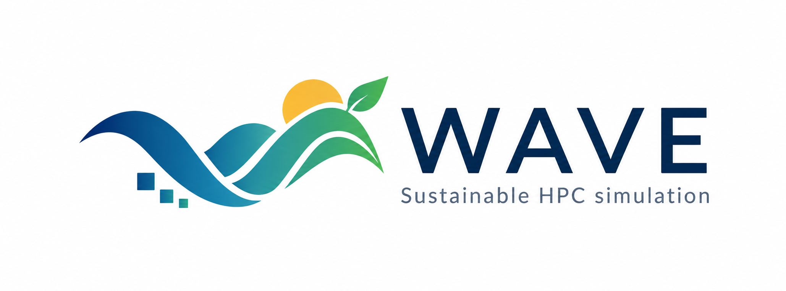
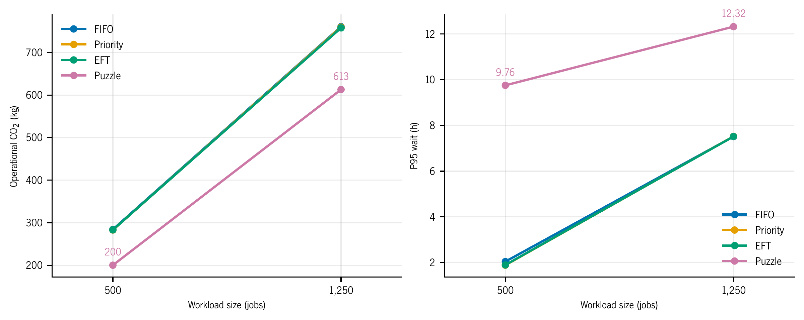

<p align="center">
  
</p>

<p align="center"><strong>A Workload-Aware Vessim Extension for sustainable HPC simulation</strong></p>
<p align="center">
  <a href="#quick-start">Get started</a> ·
  <a href="docs/README.md">Run experiments</a> ·
  <a href="datasets/README.md">Choose inputs</a> ·
  <a href="results/thesis/README.md">Explore results</a>
</p>

# WAVE

Explore how HPC scheduling changes energy use, operational grid emissions and
job waiting times. WAVE combines heterogeneous job workloads with solar and
wind generation, batteries and grid electricity in a Vessim co-simulation.

Use it to develop scheduling policies, test energy budgets and inspect the
trade-offs between when jobs run and how their power is supplied.


*The local dashboard brings machine, workload, scheduling and energy settings
into one view. Click a component to configure it.*

## What can you explore?

| Change the experiment | Inspect the effect |
|---|---|
| FIFO, Priority, EFT or Puzzle scheduling | Job placement, completion, waiting times and queue behaviour |
| Node frequencies and DVFS policies | Execution progress, node power and energy use |
| Solar, wind, battery capacity or grid budgets | Supply availability, storage use and grid imports |
| Carbon thresholds and workload arrivals | Operational emissions and the cost of deferring jobs |


WAVE advances job execution and microgrid behaviour together. Scheduling decides
which jobs can run; energy budgets constrain the power available to the clusters.
The exported traces show both sides of that interaction.

## Quick start

### 1. Install

Use **Python 3.12** for the validated application setup. From a terminal:

```bash
git clone https://github.com/pedroocarvalhoo/wave-su.git
cd wave-su
python3.12 -m venv venv
venv/bin/python -m pip install -r requirements.txt
```

This installs the simulator, plotting tools, dashboard and test dependencies.
Commands below use the virtual environment directly, so activation is optional.

<details>
<summary>Windows PowerShell</summary>

```powershell
git clone https://github.com/pedroocarvalhoo/wave-su.git
cd wave-su
py -3.12 -m venv venv
venv\Scripts\python.exe -m pip install -r requirements.txt
venv\Scripts\python.exe gui/app.py
```

For the other commands, replace `venv/bin/python` with
`venv\Scripts\python.exe`.

</details>

### 2. Open the dashboard

```bash
venv/bin/python gui/app.py
```

Open **<http://127.0.0.1:5000>**. Choose a machine under **HPC Supercomputer**,
configure the scheduler and energy components, then select **Start Simulation**.
The **Results** and **Compare** tabs let you inspect local runs; **Datasets**
shows the available workloads.

### 3. Run your first CLI experiment

For a small starting scenario, run FIFO with a grid-based compute budget:

```bash
venv/bin/python scripts/simulation_energy.py deucalion_test \
  --scheduling-policy fifo --budget-policy grid \
  --no-plots --no-snapshot --run-tag first_run
```

The driver prints the new directory under `outputs/`. It contains the monitor
time series, per-job metrics and scheduler events. This first example exports
CSVs; the [experiment guide](docs/README.md) explains plot generation and shows
carbon-aware and Puzzle configurations.

## See the results before running anything

The thesis results are already available as **PNG graphs and CSV data**.
Browse the [results index](results/thesis/README.md) for supply-profile
comparisons, carbon-threshold sensitivity and different workload sizes.



*An example of WAVE's exported evidence. The results index links each campaign
to its detailed graphs and data; it also explains which runs share inputs.*

The carbon model accounts for operational emissions from grid imports.
Interpret energy and emissions alongside job completion and waiting times:
a lower energy total can still coincide with higher grid emissions.

## Find your way around

| I want to… | Start here |
|---|---|
| Configure and run an experiment | [WAVE guide](docs/README.md) |
| Understand a scenario or input column | [Dataset guide](datasets/README.md) |
| Browse the thesis graphs and data | [Thesis results](results/thesis/README.md) |
| Read the dissertation | [thesis.pdf](thesis.pdf) |
| Develop scheduling or energy policies | [vessim/wave/](vessim/wave/) |
| Work on experiment and plotting tools | [scripts/](scripts/) |

`vessim/` contains the base co-simulation components; `vessim/wave/` adds the
HPC workloads, scheduler, resource manager and energy controllers. New runs
are written to `outputs/`, which stays local and ignored by Git.

## Development

From the installed checkout, run the maintained suite:

```bash
venv/bin/python -B -m pytest -q
```

When changing a policy, keep scheduling decisions, physical runtime progress
and power accounting consistent. Include a focused regression test for changed
behaviour and describe the workload and energy conditions used to validate it.

The compiled dissertation is available as [thesis.pdf](thesis.pdf), with its
evaluation graphs and CSV data in [the results index](results/thesis/README.md).

## Built on Vessim

WAVE extends [Vessim](https://github.com/dos-group/vessim), developed by
Philipp Wiesner and contributors, and uses Mosaik for co-simulation.
For the underlying framework, see
[Software-in-the-Loop Simulation for Developing and Testing Carbon-Aware Applications](https://doi.org/10.1002/spe.3275).

Licensed under [MIT](LICENSE).
