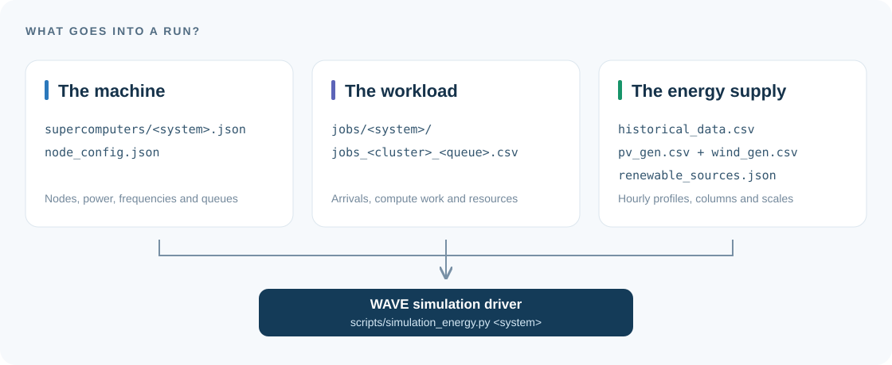
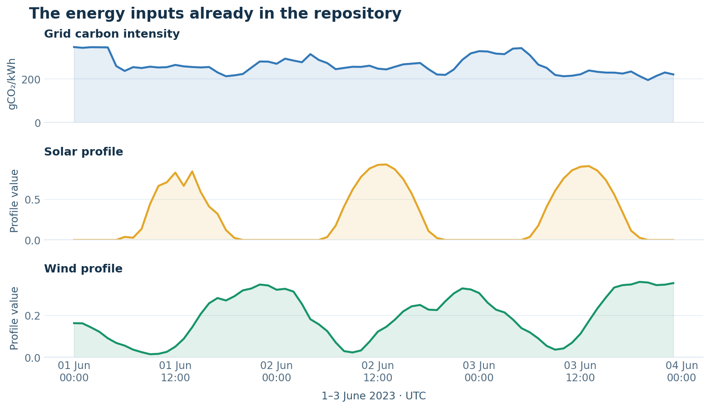
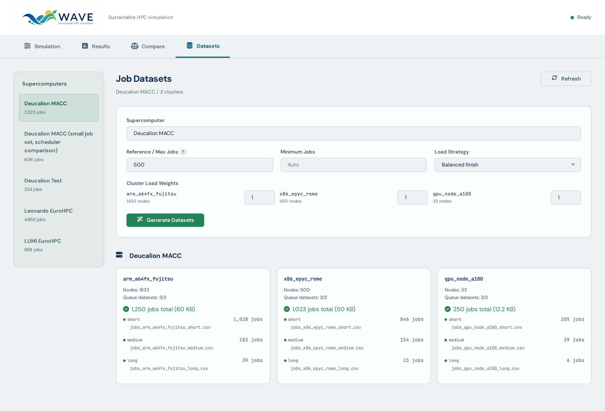

# Choose the inputs for a WAVE experiment

A run combines **a machine**, **a workload** and **energy signals**. This
directory supplies all three. The system ID passed to the simulation driver
selects a machine configuration and its matching queue CSVs.

[Back to WAVE](../README.md) · [Experiment guide](../docs/README.md) · [Thesis results](../results/thesis/README.md)



## Pick a scenario

Start with `deucalion_test` to explore the controls. Choose a larger workload
when you need more jobs or a different cluster mix. These are simulator
scenarios with synthetic workloads and modelled queue limits.

| System ID | What it contains | Jobs in this checkout | Use it for |
|---|---|---:|---|
| [`deucalion_test`](supercomputers/deucalion_test.json) | 160 ARM, 64 x86 and 12 A100 nodes | 324 | First runs and smaller experiment configurations |
| [`deucalion_small`](supercomputers/deucalion_small.json) | 1,632 ARM, 500 x86 and 33 A100 nodes | 606 | A lighter workload on the main Deucalion cluster sizes |
| [`deucalion_macc`](supercomputers/deucalion_macc.json) | 1,632 ARM, 500 x86 and 33 A100 nodes | 2,523 | The main Deucalion workload supplied with WAVE |
| [`leonardo_eurohpc`](supercomputers/leonardo_eurohpc.json) | 1,536 Ice Lake CPU and 3,456 A100 nodes | 4,853 | A CPU/GPU scenario with a larger job set |
| [`lumi_eurohpc`](supercomputers/lumi_eurohpc.json) | 2,048 EPYC Milan CPU and 2,560 MI250X nodes | 859 | A CPU/GPU scenario with different node profiles |

Counts above come from the committed queue CSVs. Regenerating a workload changes
them. The separate 500-job and 1,250-job thesis campaigns are in
[the results archive](../results/thesis/README.md).

To run a chosen scenario from the repository root:

```bash
venv/bin/python scripts/simulation_energy.py deucalion_test \
  --scheduling-policy fifo --budget-policy grid --no-plots --no-snapshot
```

## Where each input lives

| Path | What it controls |
|---|---|
| [`supercomputers/`](supercomputers/) | Scenario labels, cluster node counts, queue definitions and waiting-time bounds |
| [`node_config.json`](node_config.json) | Node types, memory and runtime parameters, idle power and frequency/power tables |
| [`jobs/`](jobs/) | Workload CSVs grouped by system, cluster and queue |
| [`historical_data.csv`](historical_data.csv) | The grid carbon-intensity time series |
| [`pv_gen.csv`](pv_gen.csv), [`wind_gen.csv`](wind_gen.csv) | Solar and wind generation profiles |
| [`renewable_sources.json`](renewable_sources.json) | Renewable profile filenames, column names, defaults and power scales |
| [`supercomputer_config.py`](supercomputer_config.py) | Configuration loading and workload-path helpers |
| [`gen_jobs.py`](gen_jobs.py) | Synthetic workload generation |

## Read a workload CSV

For example, `jobs_arm_a64fx_fujitsu_short.csv` in `jobs/deucalion_test/` holds
the short-queue jobs for that scenario's ARM cluster. Filenames follow
`jobs_<cluster>_<queue>.csv`.

| Column | Meaning | Unit |
|---|---|---|
| `job_id` | Job identifier, unique across a cluster's queue files | Integer |
| `CPI` | Cycles per instruction | Cycles/instruction |
| `#I` | Instruction count used by the runtime model | Instructions |
| `#nodes` | Requested node count | Nodes |
| `Memory_GB` | Memory input to the job model | GB |
| `Priority` | Job priority consumed by scheduling policies | Integer |
| `Arrival_Offset_s` | Arrival offset from the simulation start | Seconds |
| `Requested_Walltime_s` | Requested walltime used to classify the job into a queue | Seconds |

The supplied scenarios use `short`, `medium` and `long` queues. Their default
requested-walltime ranges are 0–24 hours, 24–168 hours and 168 hours upwards.
The scenario JSON provides the actual limits, resource caps and waiting bounds.
Requested walltime selects a queue; physical execution follows the job's compute
work, overhead and assigned frequency.

## Understand the energy signals



*A three-day window from the included files. Solar and wind are shown before
their configured power scales are applied.*

| Input | Time column | Value column | Interpretation |
|---|---|---|---|
| `historical_data.csv` | `datetime` | `carbon_intensity` | gCO₂/kWh; 8,424 hourly samples from 1 January to 17 December 2023 |
| `pv_gen.csv` | `time` | `P` | Solar profile; 8,760 hourly samples covering 2023 |
| `wind_gen.csv` | `time` | `P` | Wind profile; 8,760 hourly samples covering 2023 |

The driver aligns the renewable profiles to the carbon-series timestamps and
multiplies each profile by its configured scale in watts. Both renewable
defaults are 400,000 W; PV is enabled by default and wind is optional.
To enable both with explicit scales:

```bash
venv/bin/python scripts/simulation_energy.py deucalion_test \
  --renewable-sources pv,wind \
  --renewable-source-scale pv=400000 --renewable-source-scale wind=300000 \
  --no-plots --no-snapshot
```

Carbon intensity comes from `historical_data.csv`. Its legacy `pv_gen` column
is retained in the file, while the current renewable signal uses the separate
profile CSVs.

## Manage or create workloads

The dashboard's **Datasets** tab shows the queue files and provides workload
generation controls. Select a supercomputer in the left sidebar to see its
workloads and target it for generation:



For CLI generation, inspect the available controls first:

```bash
venv/bin/python datasets/gen_jobs.py --help
```

To deliberately replace the `deucalion_test` queue CSVs with a seeded sample:

```bash
venv/bin/python datasets/gen_jobs.py --system deucalion_test --seed 42
```

Generation overwrites that system's workload files. To experiment with a separate
workload, copy its queue CSVs into your own directory and select it with the
simulation driver's `--jobs-dir <directory>` option.
Keep the same workload and seed when comparing policies.
