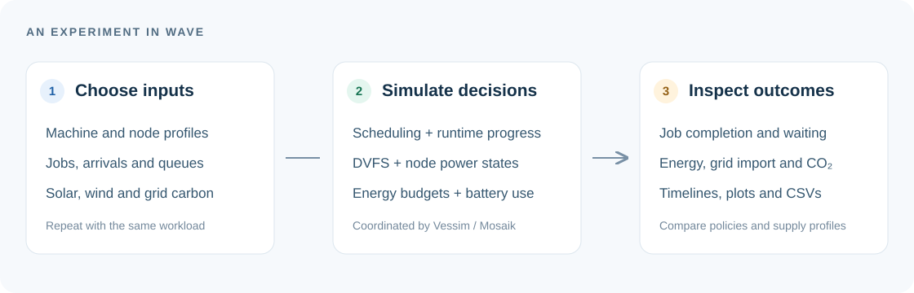
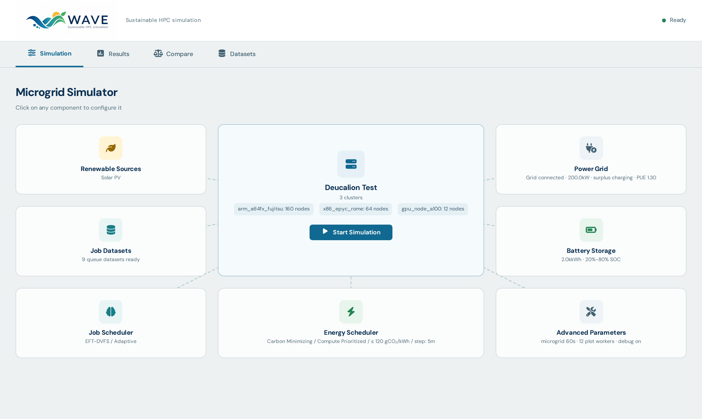
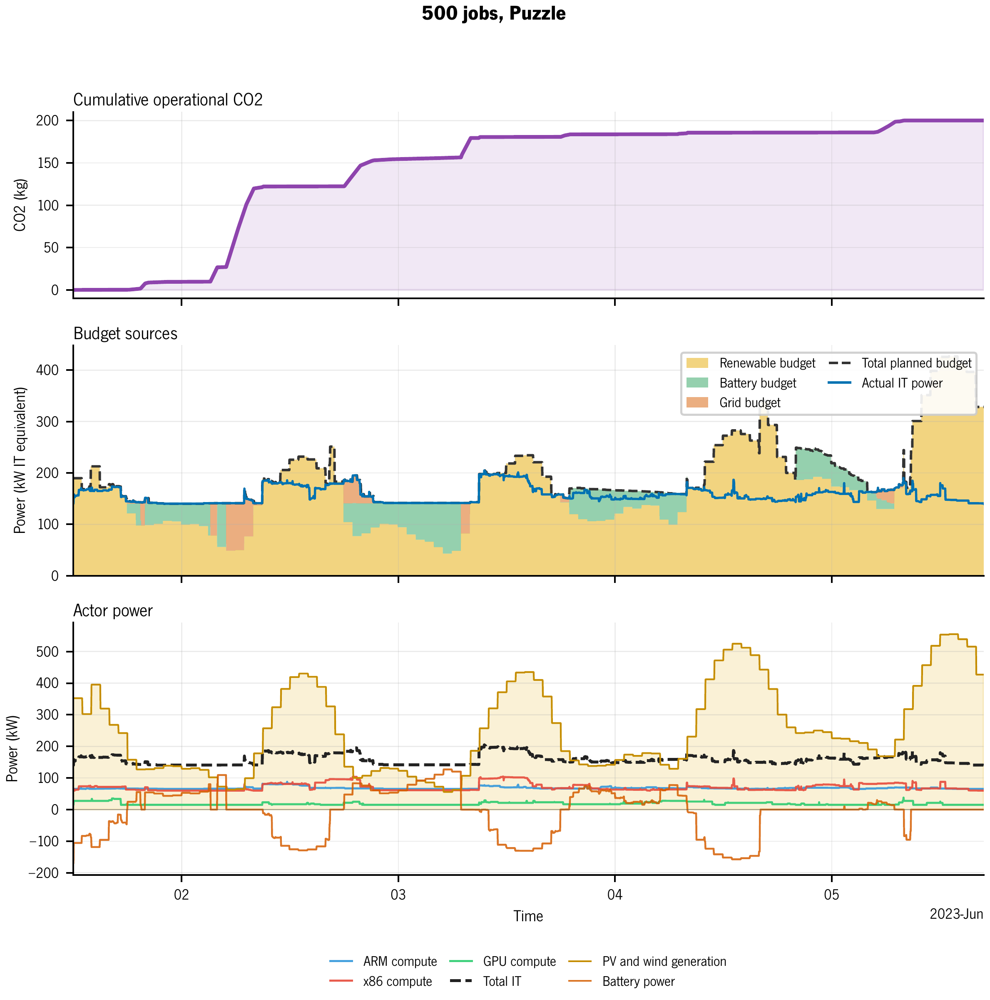

# Run an experiment with WAVE

Choose a workload, configure scheduling and energy policies, then inspect the
exported traces. This guide assumes the [installation](../README.md#quick-start)
is complete and commands are run from the repository root.

[Back to WAVE](../README.md) · [Input datasets](../datasets/README.md) · [Thesis results](../results/thesis/README.md)



## Start in the dashboard

```bash
venv/bin/python gui/app.py
```

Open <http://127.0.0.1:5000>. Click the machine, workload, scheduler or energy
components to edit their settings. **Start Simulation** launches the run and
streams its progress; **Results** opens new runs and the published thesis results, and **Compare**
places selected runs side by side.

In **Results**, **Compare** and **Datasets**, choose a supercomputer in the left
sidebar. The selection carries across these tabs, and each view shows only that
machine's data. Dataset generation also targets the selected machine.

In **Job Datasets**, an optional workload directory lets you select separate
queue CSVs. **Advanced Parameters** includes waiting-bound enforcement, the
grid override and the option to keep idle nodes on. Selecting Puzzle also
selects its required energy budget; the other scheduling policies retain the
chosen budget.



## Run from the terminal

These examples use the included `deucalion_test` workload. Every command creates
a separate run directory in `outputs/`. The configurations illustrate different
controls; a policy comparison needs the same workload, supply and energy settings.

### FIFO with a grid budget

A simple first run with CSV exports:

```bash
venv/bin/python scripts/simulation_energy.py deucalion_test \
  --scheduling-policy fifo --budget-policy grid \
  --no-plots --no-snapshot --run-tag example_fifo_grid
```

### EFT with a carbon-aware budget

Expose the normal grid budget below a carbon-intensity threshold:

```bash
venv/bin/python scripts/simulation_energy.py deucalion_test \
  --scheduling-policy eft --budget-policy carbon-minimizing \
  --carbon-grid-threshold 120 \
  --no-plots --no-snapshot --run-tag example_eft_carbon
```

The threshold is in gCO₂/kWh. Waiting-bound enforcement can still permit grid
use to help jobs meet the configured bounds.

### Puzzle with solar and wind

Use the planner together with its energy-budget and allocation policies:

```bash
venv/bin/python scripts/simulation_energy.py deucalion_test \
  --scheduling-policy puzzle --budget-policy puzzle \
  --allocation-strategy puzzle-plan --renewable-sources pv,wind \
  --no-plots --no-snapshot --run-tag example_puzzle_renewables
```

Inspect every supported option with:

```bash
venv/bin/python scripts/simulation_energy.py --help
```

## Generate plots

To generate plots at the end of a run, omit `--no-plots`. To plot later, use
`--no-plots` and keep the snapshot enabled by omitting `--no-snapshot`.
Then pass the printed output directory to the plotting tool:

```bash
venv/bin/python scripts/plot_energy.py <run-directory>
```

Replace `<run-directory>` with the actual `outputs/results_...` path. The
`schedulers.pkl` file supplies plotting inputs; it is not a checkpoint for
resuming execution. CSV-only analysis remains available without that snapshot.

## Find and read your outputs

| File | What to inspect |
|---|---|
| `config.json` | Scenario, policies and run parameters |
| `energy_simulation_result.csv` | Power over time, grid exchange, battery state and monitor emissions |
| `jobs_metrics_<cluster>.csv` | Job completion, waiting, execution and assigned resources |
| `scheduler_debug_events_<cluster>.csv` | Starts, completions, DVFS changes and resource events |
| `puzzle_*.csv` | Planner forecasts and diagnostics when Puzzle is enabled |
| `carbon_metrics.csv` | Derived energy and carbon metrics after post-processing |

The driver prints each run's location under `outputs/`; new runs are ignored
by Git. Saved thesis graphs and their CSV data are under `results/thesis/`.

For an example of a detailed result, the thesis workload plots place operational
carbon, energy budgets and actor power on a common timeline:



## Compare experiments carefully

Keep workload CSVs, machine definitions, energy profiles and resource limits
fixed while changing the policy you want to study. On Linux/WSL, set
`PYTHONHASHSEED=0` for controlled runs to fix Python hash iteration order.

Read completion counts and waiting times alongside energy and emissions. The
carbon accounting covers operational emissions from grid imports; renewable
generation and battery discharge contribute zero operational emissions in this
model. Lifecycle emissions are outside that accounting.

## Where the implementation lives

| Source | Responsibility |
|---|---|
| [`scripts/simulation_energy.py`](../scripts/simulation_energy.py) | Load inputs, build the experiment and export results |
| [`vessim/cosim.py`](../vessim/cosim.py) | Coordinate the co-simulation and microgrid |
| [`vessim/wave/cluster/`](../vessim/wave/cluster/) | Load workloads and maintain job queues |
| [`vessim/wave/scheduler/`](../vessim/wave/scheduler/) | Scheduling, runtime progress and job metrics |
| [`vessim/wave/resource_manager/`](../vessim/wave/resource_manager/) | Node state, allocations and runtime DVFS |
| [`vessim/wave/energy/`](../vessim/wave/energy/) | Compute budgets, battery dispatch and budget allocation |

Predicted runtime guides scheduling. Physical completion depends on remaining
compute work and overhead; prediction error changes the estimate used by the
scheduler.
